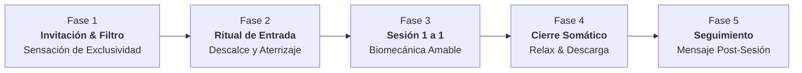

# Laboratorio de Diseño de Servicio: El ADN de Antonia & El Camino del Cliente 🧘‍♀️✨

**Cliente:** Antonia Jofré | **Consultoría:** Diego (Administración Humana)  
**Fecha:** 26 de Octubre de 2026  
**Objetivo Estratégico:** Aterrizar qué ofrece realmente Antonia (su propuesta única de valor) y mapear el recorrido de la alumna (Customer Journey), antes de fijar números arbitrarios o caer en la trampa de la subvaloración ($24k / $50k).

---

## 🧭 1. El Diagnóstico del Impulso de Precios ($24.000 / $50.000)

Cuando Antonia piensa en cobrar **$24.000** (por 4 clases al mes) y **$50.000** (por 8 clases al mes), desde la metodología de Administración Humana detectamos un patrón clínico clásico:

### A. La Trampa de la "Tarifa de Gimnasio Masivo"
* **$24.000 por 4 clases al mes = $6.000 CLP por sesión personalizada.**
* $6.000 CLP es lo que cobra un taller grupal masivo de 20 o 30 personas en una junta de vecinos o un gimnasio municipal.
* Al trasladar ese número a una **sesión 1 a 1 exclusiva en su propio living**, Antonia está cometiendo una distorsión grave:
  1. **Invisibiliza el costo del espacio:** Limpiar, desocupar, aromatizar, calentar y recibir a alguien en la intimidad de su casa.
  2. **Invisibiliza la absorción de energía:** Una sesión 1 a 1 de movimiento somático exige presencia radical, escucha emocional, corrección biomecánica y contención. Desgasta 5 veces más energía que dar una clase de zumba donde solo pones la música y bailas al frente.
  3. **Genera resentimiento inconsciente:** Si Antonia tiene un día difícil con Mateo o Roma, y tiene que atender a una persona durante una hora completa por solo $6.000, su cerebro sentirá que está regalando su tiempo y surgirá la frustración o el deseo de cancelar.

### B. El Diagnóstico de Diego: "Falta Aterrizar el Servicio"
Diego acertó quirúrgicamente: **el precio no se inventa en el aire ni se pone por miedo; el precio es el reflejo natural del valor del servicio y del camino del cliente.**

---

## 💎 2. ¿Qué Ofrece Ella como Antonia? (El ADN Somático Único)

Antonia no vende "ejercicio físico", "fitness" ni "quemar calorías". Lo que ella ofrece en Concepción es algo extremadamente escaso:

```
┌────────────────────────────────────────────────────────────────────────┐
│                   EL ADN DIFERENCIAL DE ANTONIA                       │
├────────────────────────────────────────────────────────────────────────┤
│ 1. Pedagogía Somática para "Cuerpos Cansados"                           │
│    No fuerza, no castiga. Trabaja desde la descompresión del sistema   │
│    nervioso: bajar de la alerta crónica (simpático) a la calma (paras.)│
├────────────────────────────────────────────────────────────────────────┤
│ 2. El Living como "Santuario Seguro" (Cero Juicio)                     │
│    Los gimnasios son ruidosos, llenos de espejos, luces frías y miradas│
│    intimidantes. El living de Antonia es silencio, luz cálida, aroma   │
│    y cobijo absoluto.                                                  │
├────────────────────────────────────────────────────────────────────────┤
│ 3. Ojo Biomecánico Personalizado 1 a 1                                 │
│    Lectura postural inmediata: bruxismo, rectificación cervical, dolor │
│    lumbar, suelo pélvico postparto, articulaciones sobrecargadas.      │
├────────────────────────────────────────────────────────────────────────┤
│ 4. Empatía Sensorial y Humana                                         │
│    Antonia sabe lo que pesa la vida real, la maternidad, el insomnio y │
│    la sobrecarga. Su trato no es de entrenadora militar; es de         │
│    acompañamiento sanador y amable.                                    │
└────────────────────────────────────────────────────────────────────────┘
```

> **Conclusión de Posicionamiento:**  
> Antonia no compite con el gimnasio ni con una clase de YouTube. Compite con el masajista, el kinesiólogo privado o la sesión de autocuidado terapéutico. **Por eso no puede cobrar tarifa de clase de barrio.**

---

## 🛤️ 3. El Camino del Cliente (Customer Journey de 5 Fases)

Para que el servicio se sienta profesional, transformador y justifique un arancel digno sin culpa, diseñamos el recorrido de la alumna paso a paso:



### Fase 1: La Invitación & El "Mapa Corporal Previo" (Antes de la 1ª Clase)
* **La Experiencia:** La alumna no compra un link; recibe una invitación personal porque Antonia la eligió para sus únicos 2 cupos.
* **El Detalle Profesional:** Antonia le envía por WhatsApp un micro-formulario de 4 preguntas simples ("Ficha Breve de Escucha"):
  1. *¿Dónde sientes que acumulas más tensión hoy? (cuello, espalda baja, caderas, mandíbula).*
  2. *¿Tienes alguna lesión, cirugía o dolor que deba cuidar?*
  3. *¿Qué necesita tu cuerpo en este momento: desestresarse, estirarse o recuperar fuerza suave?*
  4. *¿Cómo está tu nivel de energía habitual de 1 a 10?*
* **Impacto:** Antes de que ponga un pie en la casa, la alumna ya siente: *"Esta no es una clase genérica; esto es salud privada y personalizada para mí"*.

### Fase 2: El Ritual de Llegada (Minutos 0 a 7)
* **La Atmósfera:** Puerta abierta, aroma suave (lavanda o eucalipto), luz cálida (sin tubos fluorescentes), música ambiental a volumen sutil.
* **El Descalce:** La alumna se saca los zapatos en la entrada (símbolo de dejar la calle y el estrés afuera).
* **El Check-in Verbal (3 min):** Un vaso de agua / infusión tibia: *"¿Cómo vienes hoy? ¿Dormiste bien? ¿Dónde te tira el cuerpo hoy?"*.

### Fase 3: La Sesión Somática Central (Minutos 7 a 42)
* **Principio Rector:** *"El cuerpo manda hoy"*. Si la alumna llega con jaqueca o menstruación dolorosa, la sesión se adapta a descompresión profunda en el suelo. Si viene con energía, se trabaja faja abdominal profunda y pilates somático.
* **Ajustes amables:** Corrección táctil suave y respetuosa con consentimiento (*"¿puedo tocar tus costillas para mostrarte cómo respirar hacia los lados?"*).

### Fase 4: Cierre Somático & Descompresión (Minutos 42 a 50)
* **Shavasana / Relax guiado:** Manta suave si tiene frío, ojos cerrados, escaneo corporal de 5 minutos para que el sistema nervioso consolide el alivio.
* **Salida tranquila:** Sin prisas, regreso gradual al movimiento, sensación de liviandad corporal inmediata.

### Fase 5: El Toque Invisible Post-Sesión (El Secreto de Fidelización)
* **A las 24 horas:** Antonia le manda una nota de voz o mensaje breve de 20 segundos por WhatsApp:  
  > *"Hola [Nombre], ¿cómo amaneció tu cuello y tu espalda hoy? Recuerda tomar harta agua y no apretar los hombros frente al computador. Nos vemos el [Día] ✨"*.
* **Resultado:** La alumna queda cautivada. Siente que tiene una terapeuta corporal personal dedicada a su bienestar. Cero deserción.

---

## 📊 4. Investigación de Mercado: Tarifas Reales en Gran Concepción

Para darle datos duros a Antonia y despejar sus dudas sobre los precios:

| Tipo de Servicio | Formato / Ubicación | Tarifa por Sesión | Costo Mensual (4 sesiones) | Costo Mensual (8 sesiones) |
| :--- | :--- | :---: | :---: | :---: |
| **Gimnasio Masivo (SmartFit / Sportlife)** | Grupal (30+ personas) | — | $30.000 – $45.000 + matrícula | — |
| **Personal Trainer Gimnasio** | 1 a 1 en gym lleno de gente | $15.000 – $22.000 | $60.000 – $88.000 | $120.000 – $170.000 |
| **Kinesiología / Pilates Reformer** | Estudio privado (Concepción / San Pedro) | $20.000 – $35.000 | $80.000 – $140.000 | $160.000 – $260.000 |
| **Yoga / Masaje Terapéutico a Domicilio** | 1 a 1 en casa del cliente | $22.000 – $30.000 | $88.000 – $120.000 | $175.000 – $240.000 |
| **Antonia: Propuesta Subvalorada ($24k / $50k)** | 1 a 1 íntimo en living | **$6.000 / sesión** ❌ | **$24.000** ❌ *(Inviable)* | **$50.000** ❌ *(Inviable)* |
| **Antonia: Rango Recomendado (Piloto Círculo)** | 1 a 1 íntimo en living | **$10.000 – $12.500** ✅ | **$40.000 – $50.000** ✅ | **$75.000 – $90.000** ✅ |

### El Diagnóstico de la Tabla:
* Si Antonia cobra **$24.000 por mes (4 clases)**, está cobrando **menos de la mitad** que cualquier instructor de personal en Concepción, degradando su percepción de calidad.
* Un precio de confianza para partir con amigas/ex-alumnas es:
  * **Pase 1x/semana (4 clases/mes):** **$40.000 a $50.000 CLP** ($10.000 a $12.500 por sesión 1 a 1).
  * **Pase 2x/semana (8 clases/mes):** **$75.000 a $90.000 CLP** ($9.375 a $11.250 por sesión 1 a 1).
* **Si la alumna lo encuentra caro:** Antonia tiene la opción de ofrecer **Sesión Dúo** (2 amigas juntas en el living):
  * **$30.000 c/u por 4 clases al mes** = Antonia recibe **$60.000 por esa misma hora de trabajo**, y la alumna paga solo $7.500 por sesión.

---

## ☕ 5. Guía de Preguntas para que Diego Converse con Antonia

Diego, en tu próxima conversación con ella (en un café o llamada tranquila), puedes guiarla con estas 4 preguntas clave para terminar de aterrizar el servicio sin abrumarla:

1. **Sobre la Experiencia:**  
   *"Anto, cuando alguien entre a tu casa a tomar esta clase, ¿qué quieres que sienta en los primeros 5 minutos? ¿Cómo quieres que se diferencie de una clase ruidosa de gimnasio?"*
2. **Sobre el Desgaste Personal:**  
   *"Si tienes una semana cansadora con Mateo o Roma, y viene una alumna a tu casa, ¿qué valor mínimo te hace sentir contenta, valorada y con ganas de recibirla, en vez de sentir que te estás regalando por chauchas?"*
3. **Sobre las Alumnas de Confianza:**  
   *"Piensa en las 3 personas a las que les vas a escribir: ¿Quiénes son? ¿Qué dolores tienen habitualmente? ¿Trabajan sentadas, son mamás, tienen sobrecarga?"*
4. **Sobre la Opción Dúo vs. Individual:**  
   *"Si a alguna le acomoda más pagar un poco menos, ¿te tinca que vengan 2 amigas juntas en el mismo horario por $30k o $35k cada una? Así tú ganas $60k-$70k por esa hora y ellas pagan menos."*

---

*Documento estratégico elaborado para la Dirección de Clientes • Administración Humana (Diego)*
